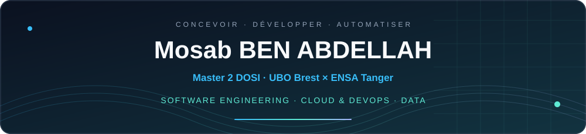

 

 

**🎯 À la recherche d’un stage PFE de six mois en France, à partir d’avril 2027**  
*Développement backend & full stack · Cloud & DevOps · Data Engineering*  
📍 Brest, France · Double diplôme **UBO × ENSA Tanger**

---

### `$ whoami`

Je suis **Mosab BEN ABDELLAH**, étudiant en **Master 2 Informatique, parcours DOSI — Développement lOgiciel des Systèmes d’Information — à l’Université de Bretagne Occidentale**, en double diplôme avec le cycle ingénieur en **Génie Informatique de l’ENSA Tanger**.

Mes stages chez **Tanger Med Port Authority** et **Yazaki Morocco** m’ont permis de développer des applications liées à des besoins métier concrets. Dans mes projets en équipe, je contribue au **backend**, à la **conteneurisation** et à l’**automatisation de la livraison**, tout en explorant la BI et l’IA appliquée.

---

### 🚀 Projets à découvrir

<table>
<tr>
<td width="50%" valign="top">
<h4>☁️ <a href="https://github.com/BENABDELLAHMosab/dirhamy_mba">Dirhamy — Finances personnelles</a></h4>

<code>AWS EC2</code> <code>Docker</code> <code>GitHub Actions</code> <code>Nginx</code>

Application de gestion des finances personnelles, développée en <b>équipe de cinq</b> avec Scrum et GitHub Projects.

<ul>
<li><b>Ma contribution :</b> responsabilité principale de l’infrastructure et du déploiement ; provisionnement et configuration d’une instance AWS EC2.</li>
<li><b>Livraison :</b> gestion des accès serveur, DNS, HTTPS avec Nginx/Certbot et automatisation CI/CD avec GitHub Actions.</li>
</ul>
Cloud · Infrastructure · Déploiement
</td>
<td width="50%" valign="top">
<h4>📊 <a href="https://github.com/BENABDELLAHMosab/Data-Warehouse-ETL-Pipeline">Data Warehouse — Pipeline ETL & BI</a></h4>

<code>PostgreSQL</code> <code>Pentaho PDI</code> <code>Power BI</code> <code>DAX</code>

Projet académique de transformation de données CSV/Excel en entrepôt analytique et tableaux de bord.

<ul>
<li><b>Chaîne de données :</b> staging, nettoyage, dédoublonnage, contrôles qualité et recherches dimensionnelles.</li>
<li><b>Architecture :</b> schéma en étoile PostgreSQL et visualisation Power BI/DAX ; transformations et rapport consultables dans le dépôt.</li>
</ul>
Data Engineering · Modélisation · Analyse décisionnelle
</td>
</tr>
<tr>
<td width="50%" valign="top">
<h4>🏨 <a href="https://github.com/BENABDELLAHMosab/flutter_Project">BookNest — Réservation hôtelière</a></h4>

<code>Flutter</code> <code>Dart</code> <code>Firebase</code> <code>Cloud Firestore</code>

Application mobile <b>réalisée en binôme</b>, avec parcours client et espace d’administration.

<ul>
<li><b>Fonctionnalités :</b> authentification, catalogue d’hôtels, réservations, favoris, historique et factures PDF.</li>
<li><b>Conception :</b> architecture MVC, gestion des rôles client/admin et persistance avec Cloud Firestore.</li>
</ul>
Mobile · Authentification · Gestion des réservations
</td>
<td width="50%" valign="top">
<h4>⚙️ <a href="https://github.com/BENABDELLAHMosab/gradle-app">Java & Gradle — CI/CD</a></h4>

<code>Java</code> <code>Gradle</code> <code>GitHub Actions</code> <code>Docker</code>

Travaux universitaires sur la compilation, les tests et la livraison automatisée d’une application Java.

<ul>
<li><b>Pipeline :</b> compilation, exécution des tests et conservation des artefacts.</li>
<li><b>Publication :</b> jobs de construction d’images Docker sur GHCR et de création de releases à partir de tags versionnés.</li>
</ul>
GitLab CI/CD également pratiqué · <a href="https://github.com/BENABDELLAHMosab/gradle-app/blob/main/.github/workflows/ci.yml">Voir le workflow</a>
</td>
</tr>
</table>

<b>Autres projets : backend, infrastructure et IA appliquée</b>

- **Wasil — projet d’équipe :** contributions backend C#/.NET, Docker Compose, GitHub Actions/Docker Hub, déploiement sur VPS DigitalOcean et participation à l’intégration de Keycloak.
- **GrowTrack — infrastructure & CI/CD :** Dockerfiles et configurations Compose ; correction des tests Jest/Supertest et Vitest ; build et publication d’images conditionnés à la réussite des tests. Application d’équipe Vue.js/Express/PostgreSQL.
- **StreamLine — équipe de quatre :** contribution à l’infrastructure avec un coéquipier ; environnement distribué sur cinq VM VMware/Vagrant, services Docker, reverse proxy Nginx, stockage MinIO et supervision Prometheus/Grafana.
- **BricoliRent — réalisé en binôme :** application de location de matériel Java/Jakarta EE ; JSF, CDI, Hibernate et PostgreSQL ; réservations, paiements, cautions et retours.
- **Détection de pièces marocaines — réalisé en binôme :** constitution et annotation du dataset, entraînement et évaluation YOLOv8n, interface Streamlit pour afficher les détections et calculer le total en MAD. Python, Ultralytics, Roboflow et Google Colab.

---

### 🧰 Compétences techniques

Technologies utilisées dans mes stages et projets, y compris mes travaux universitaires :

| Domaine | Technologies et outils |
| :--- | :--- |
| **Backend** | Node.js · Express.js · C# / ASP.NET Core · Java / Jakarta EE · Hibernate |
| **Web & mobile** | React · TypeScript · JavaScript · Flutter / Dart · JSF / Facelets |
| **Cloud & DevOps** | Docker · Docker Compose · GitHub Actions · GitLab CI/CD · Gradle · Linux · AWS EC2 · DigitalOcean · Nginx |
| **Données & BI** | SQL · PostgreSQL · MongoDB · Firebase / Cloud Firestore · Pentaho PDI · Power BI · DAX |
| **Infrastructure & observabilité** | VMware · Vagrant · MinIO · Prometheus · Grafana |
| **IA appliquée** | Python · YOLOv8n · Ultralytics · Roboflow · Streamlit · Google Colab |

Travail en équipe : Git · Scrum · GitHub Projects · Analyse des besoins · Tests et validation.

---

### 💼 Expériences professionnelles

| Période | Organisation | Missions et contributions |
| :--- | :--- | :--- |
| **Juil. – août 2026** | **Tanger Med Port Authority** Tanger · Hybride | **Stage PFA Full Stack :** conception et développement d’un UI Builder No-Code/Low-Code ; éditeur visuel, composants réutilisables, prévisualisation, rôles et workflow de validation. Modélisation des pages, versions et historiques. React · TypeScript · Node.js · Express.js · MongoDB · Docker |
| **Juil. – sept. 2025** | **Yazaki Morocco** Tanger | **Stage Développement Web & SI :** contribution à la migration d’une plateforme Power Apps vers une application web ; développement backend et modélisation des données. Node.js · Express.js · PostgreSQL |
| **Juil. – sept. 2024** | **Yazaki Morocco** Département Ingénierie · Tanger | **Stage Amélioration continue & digitalisation :** recueil des problèmes terrain lors des Gemba Walks ; application d’aide à la résolution intégrant les cartes TRIZ, centralisation et analyse des données. Power Apps · SharePoint · Power BI |

### 🎓 Formation

| Parcours | Établissement |
| :--- | :--- |
| **Master 2 Informatique — DOSI · 2026–2027** | Université de Bretagne Occidentale, Brest · En cours |
| **Cycle ingénieur — Génie Informatique** | ENSA Tanger · Dans le cadre du double diplôme |

---

### 📊 Activité & statistiques GitHub

<!-- Les cartes s’adaptent au thème clair ou sombre de GitHub. -->
<a href="https://github.com/BENABDELLAHMosab">
<picture>
<source media="(prefers-color-scheme: dark)" srcset="https://github-readme-stats.vercel.app/api?username=BENABDELLAHMosab&amp;show_icons=true&amp;hide_rank=true&amp;hide_border=true&amp;bg_color=0D1117&amp;title_color=38BDF8&amp;text_color=CBD5E1&amp;icon_color=5EEAD4" />

</picture>
</a>
<a href="https://github.com/BENABDELLAHMosab?tab=repositories">
<picture>
<source media="(prefers-color-scheme: dark)" srcset="https://github-readme-stats.vercel.app/api/top-langs/?username=BENABDELLAHMosab&amp;layout=compact&amp;card_width=495&amp;hide_border=true&amp;bg_color=0D1117&amp;title_color=38BDF8&amp;text_color=CBD5E1&amp;langs_count=6" />

</picture>
</a>

  

<a href="https://github.com/BENABDELLAHMosab">
<picture>
<source media="(prefers-color-scheme: dark)" srcset="https://github-readme-streak-stats.herokuapp.com/?user=BENABDELLAHMosab&amp;theme=dark&amp;hide_border=true&amp;background=0D1117&amp;fire=5EEAD4&amp;ring=38BDF8&amp;currStreakLabel=38BDF8" />

</picture>
</a>

Les pourcentages décrivent le code des dépôts, pas le niveau de maîtrise. Ces cartes sont fournies par des services externes et peuvent être mises en cache ou temporairement indisponibles.

---

### 🤝 Échangeons sur une opportunité de PFE ou un projet technique

**[mossabbenabdellah7@gmail.com](mailto:mossabbenabdellah7@gmail.com)**

 

